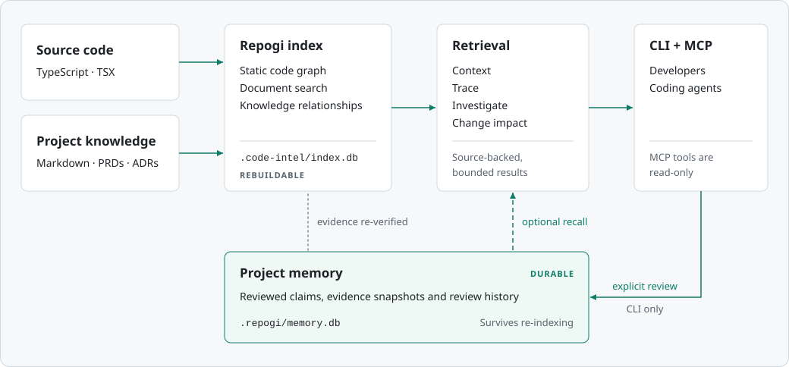

<div align="center">
  

# Repogi — Repo Graph Intelligence

**Local-first code intelligence and dependency graph analysis for AI coding agents.**

Understand source references, navigate dependencies, retrieve relevant code context, and trace the impact of Git changes—with source-backed evidence.

[Install](#install) · [Get started](#quick-start) · [Explore features](#features) · [CLI examples](#usage) · [MCP integration](#ai-agent-integration) · [Architecture](#how-repogi-works) · [Limitations](#current-status-and-limitations)

</div>

> **Give coding agents a map of the codebase, not just a pile of files.**

**Repogi** is an open-source, Rust-based repository intelligence tool. It indexes **TypeScript and TSX** source code locally, connects declarations and references in a **static code graph**, and returns compact, evidence-backed answers about what code does, what depends on it, and what a proposed change might affect.

Built for developers and AI coding assistants that need more than grep, Repogi offers a **command-line interface (CLI)** and a read-only **Model Context Protocol (MCP)** server. There is **no hosted service, API key, background daemon, or model dependency**. The repository being analyzed is never executed by the indexer.

**At a glance:** TypeScript/TSX · Rust · SQLite + FTS5 · Tree-sitter · BLAKE3 · Git change impact · MCP · Offline-first

## Why Repogi?

When an AI coding agent investigates an unfamiliar codebase, text search and whole-file reads are useful—but they don't reliably distinguish actual bindings from same-name matches or explain how changes propagate through imports, exports, and call sites.

Repogi gives agents a **source-backed repository graph**, so they can:

- **Find the right code** — discover declarations, callers, references, and their file/line locations.
- **Understand dependencies** — follow direct and transitive relationships across imports, aliases, and re-exports.
- **Retrieve focused context** — fetch relevant snippets under explicit response-size budgets instead of always reading whole files.
- **Review changes** — inspect which declarations and static consumers a Git change may affect.
- **Know what is uncertain** — distinguish resolved evidence from ambiguity, unsupported patterns, stale indexes, and incomplete results.

Repogi does **not** claim to prove runtime safety, perfectly resolve every TypeScript construct, or guarantee token savings. Evidence and limits come together.

## Features

| Capability | What Repogi provides |
| --- | --- |
| **Local repository indexing** | Parse `.ts` and `.tsx` files into a persistent, local SQLite graph and FTS5 search index. Respect `.gitignore` and supported exclusions. |
| **Incremental indexing** | Use BLAKE3 file hashes to skip unchanged files and update existing graph records. |
| **Symbol and reference navigation** | Inspect declarations, static calls, reference sites, JSX component use, and source ranges. |
| **Dependency graph exploration** | Follow upstream consumers and downstream dependencies with bounded traversal and completeness reporting. |
| **TypeScript module resolution** | Track relative imports, `tsconfig`/`jsconfig` aliases, re-exports, and barrel files where supported. |
| **Context retrieval** | Produce ranked, deduplicated source evidence with compact and detailed output modes. |
| **Git change impact analysis** | Compare Git states to report changed declarations and potential direct/transitive consumers. |
| **Evidence and uncertainty** | Include source locations, resolution status, confidence or limitations, and explicit truncation where applicable. |
| **CLI + MCP server** | Run locally using text/JSON CLI output or read-only stdio MCP tools for coding agents. |

**Experimental and advisory:** `impact --tests` discovers likely affected tests using static links; it does not execute tests. Verification manifests (`impact --manifest`, `manifest-verify`) and semantic retrieval (`context --retrieval semantic`) are also available, but should be treated as evolving interfaces rather than guarantees of coverage or correctness.

## Install

Repogi ships as a single self-contained `repogi` executable. You do not need Rust, Cargo, Node.js or Python to run it.

> **Release status:** no prebuilt binary release has been published yet. The commands below are the release interface and start working once the first GitHub Release exists. Until then, [build from source](#build-from-source).

### macOS and Linux

```bash
curl -fsSL https://github.com/thinkgrid-labs/repogi/releases/latest/download/install.sh | sh
repogi --version
```

The installer detects your OS and CPU and downloads the matching archive from the official GitHub Release. It verifies the archive against the release's `SHA256SUMS`, then installs only the `repogi` executable into `~/.local/bin`. It never uses `sudo` or edits your shell profile. If that directory is not on your `PATH`, it prints the line to add. An existing installation is replaced only after the new binary verifies and runs.

Pin a release (including previews) or choose another directory:

```bash
curl -fsSL https://github.com/thinkgrid-labs/repogi/releases/download/v0.1.0/install.sh | sh -s -- --version 0.1.0
curl -fsSL https://github.com/thinkgrid-labs/repogi/releases/latest/download/install.sh | sh -s -- --install-dir "$HOME/bin"
```

Prefer to read the script first? Download, inspect, then run it:

```bash
curl -fsSLO https://github.com/thinkgrid-labs/repogi/releases/latest/download/install.sh
less install.sh
sh install.sh --help
sh install.sh
```

### Windows

In PowerShell (no administrator rights; the execution policy is not changed):

```powershell
irm https://github.com/thinkgrid-labs/repogi/releases/latest/download/install.ps1 | iex
```

This installs `repogi.exe` into `%LOCALAPPDATA%\Programs\Repogi\bin` after verifying `SHA256SUMS`. The script does not change `PATH` unless you ask it to: it prints the exact command, or adds the directory to your *user* `PATH` when run with `-AddToPath`. To inspect first, or to pin a version:

```powershell
Invoke-WebRequest https://github.com/thinkgrid-labs/repogi/releases/latest/download/install.ps1 -OutFile install.ps1
notepad install.ps1
powershell -NoProfile -ExecutionPolicy Bypass -File .\install.ps1 -Version 0.1.0 -AddToPath
```

`-ExecutionPolicy Bypass` applies to that one PowerShell process only.

### Direct download and manual verification

Every [GitHub Release](https://github.com/thinkgrid-labs/repogi/releases) carries one archive per platform and a `SHA256SUMS` manifest:

| Platform | Archive |
| --- | --- |
| Linux x86_64 (glibc 2.34+) | `repogi-<version>-x86_64-unknown-linux-gnu.tar.gz` |
| Linux ARM64 (glibc 2.34+) | `repogi-<version>-aarch64-unknown-linux-gnu.tar.gz` |
| macOS Apple silicon (11+) | `repogi-<version>-aarch64-apple-darwin.tar.gz` |
| macOS Intel (11+) | `repogi-<version>-x86_64-apple-darwin.tar.gz` |
| Windows x64 | `repogi-<version>-x86_64-pc-windows-msvc.zip` |

```bash
VERSION=0.1.0 TARGET=x86_64-unknown-linux-gnu
curl -fsSLO "https://github.com/thinkgrid-labs/repogi/releases/download/v$VERSION/repogi-$VERSION-$TARGET.tar.gz"
curl -fsSLO "https://github.com/thinkgrid-labs/repogi/releases/download/v$VERSION/SHA256SUMS"
sha256sum --check --ignore-missing SHA256SUMS      # macOS: shasum -a 256 --check --ignore-missing SHA256SUMS
tar -xzf "repogi-$VERSION-$TARGET.tar.gz"
install -m 755 "repogi-$VERSION-$TARGET/repogi" ~/.local/bin/repogi
```

On Windows, compare `(Get-FileHash .\repogi-<version>-x86_64-pc-windows-msvc.zip).Hash` with the `SHA256SUMS` line. Each archive also contains `LICENSE`, the third-party notices and a `BUILD-INFO.json` that records the source commit, compiler and target. Release builds carry GitHub build provenance, which you can check with the [GitHub CLI](https://cli.github.com/): `gh attestation verify <archive> --repo thinkgrid-labs/repogi`. You can also pass `--verify-attestation` (`-VerifyAttestation` on Windows) to the installers.

### Build from source

For contributors, or for platforms without a prebuilt binary (musl/Alpine, older glibc, other CPUs), install Rust 1.85 or later, Git and a C compiler:

```bash
git clone https://github.com/thinkgrid-labs/repogi.git
cd repogi
cargo install --path crates/cli --locked
repogi --version
```

Alternatively, build without installing: `cargo build --release --locked -p code-intel-cli`, then run `./target/release/repogi`. Repogi is not published to crates.io.

## Quick start

Index a TypeScript/TSX project and ask for context:

```bash
cd /path/to/your/typescript-project
repogi index .
repogi status
repogi context "authentication flow" --format text
```

The index lives inside the project, in `.code-intel/index.db` (a name kept for compatibility with earlier versions). Indexing is explicit: rerun `repogi index .` after edits to update the graph. Indexing reads source files only and never runs the project's scripts or code. Git is needed only for change-impact commands.

### Multiple repositories

One installed `repogi` serves every project on your machine, but each repository keeps its own index; there is no shared global graph:

```bash
repogi index ~/projects/frontend     # writes ~/projects/frontend/.code-intel/
repogi index ~/projects/backend      # writes ~/projects/backend/.code-intel/
```

An MCP server answers only for the `--root` it was started with, so configure one server per project (see [AI agent integration](#ai-agent-integration)).

Browse the [public documentation](docs/README.md). See the [installation guide](docs/DEVELOPER_PREVIEW_INSTALLATION.md), [release assets and verification](docs/RELEASES.md), [MCP configuration](docs/MCP.md), [reference-first workflows](docs/REFERENCE_FIRST_AGENT_WORKFLOWS.md) and [navigation limits](docs/REFERENCE_NAVIGATION_LIMITS.md).

## Usage

### CLI commands

| Command | Purpose |
| --- | --- |
| `repogi index <path>` | Create or update a local index. |
| `repogi status` | Inspect the nearest repository index and its state. |
| `repogi context <task>` | Retrieve relevant code context and source evidence. |
| `repogi graph` | Inspect static graph relationships and unresolved sites. |
| `repogi impact [path]` | Analyze the potential impact of Git changes. |
| `repogi manifest-verify` | Check a verification manifest. |
| `repogi mcp` | Start a read-only MCP server over stdio. |

### Find code context and references

```bash
# Ranked, budgeted source evidence (JSON by default)
repogi context "session refresh" --max-tokens 2000

# A human-readable view
repogi context "session refresh" --format text

# Inspect graph edges in a specific source file
repogi graph --path src/auth.ts --limit 100
```

`--max-tokens` is a **conservative estimate** based on UTF-8 bytes, not a count from a particular model tokenizer.

### Trace Git change impact

```bash
# HEAD compared with the working tree
repogi impact --base HEAD

# Compare branches/commits
repogi impact --base main --head feature

# See transitive evidence paths
repogi impact --base main --detail --depth 3

# Advisory test candidates (does not run tests)
repogi impact --base HEAD --tests

# Machine-readable report
repogi impact --base HEAD~1 --head HEAD --format json
```

Impact analysis builds separate Git snapshot indexes under `.code-intel/impact/`; it does not change the repository's source files, Git index, or refs. A graph dependency is **not** proof that a change will break another component.

## How Repogi works

Repogi uses **Tree-sitter parsing, static binding, and SQLite graph storage** to make repository relationships accessible to coding assistants. The flow below illustrates the architecture; the animation is decorative and the diagram remains readable without motion.

<div align="center">
  
</div>

<details>
<summary>View a text-only architecture diagram</summary>

```text
TypeScript / TSX repository
          |
          v
  Discover + parse files
  Tree-sitter / BLAKE3
          |
          v
   Static bindings
   Imports / calls / references / JSX
          |
          v
  SQLite + FTS5 code graph <------- Git snapshots
          |
          +----> Reference navigation
          +----> Dependency traversal
          +----> Context retrieval
          +----> Git impact + advisory test candidates
          |
          v
     CLI / MCP server
          |
          v
      Coding agents
```

</details>

**Evidence matters.** A response can include a confirmed source binding, unresolved/ambiguous sites, an explicit incomplete-coverage flag, or an out-of-scope limitation. Repogi reports those differences rather than pretending every edge is certain.

## AI agent integration

Repogi exposes a **read-only Model Context Protocol (MCP)** server that AI coding assistants can use to navigate a project. The server is local, does not start an agent, and makes no model API calls.

| MCP tool | Purpose |
| --- | --- |
| `atlas_context` | Retrieve task-relevant declarations and context. |
| `atlas_symbol` | Inspect a declaration. |
| `atlas_references` | Find direct static reference sites. |
| `atlas_dependencies` | Traverse upstream/downstream relationships. |
| `atlas_status` | Inspect index state and freshness. |
| `atlas_impact` | Analyze change impact; opt-in only. |

The `atlas_*` tool identifiers are intentionally retained for backward compatibility with existing MCP clients. The server itself is branded Repogi.

### Claude Code

In the repository you want the agent to inspect:

```bash
repogi index .
claude mcp add --transport stdio --scope project repogi -- "$(command -v repogi)" mcp \
  --root "$PWD" --profile compact \
  --tools atlas_context,atlas_references,atlas_dependencies
```

`--scope project` writes the entry to that repository's `.mcp.json`, so run these two commands once in each project: every project gets its own server, root and index. See the [Claude Code MCP configuration example](examples/agents/claude.navigation.mcp.json.example).

### Codex

Add a configuration entry in the trusted project's `.codex/config.toml` using absolute paths. `command -v repogi` prints the executable path (the installers use `~/.local/bin/repogi`, or `%LOCALAPPDATA%\Programs\Repogi\bin\repogi.exe` on Windows):

```toml
[mcp_servers.repogi]
command = "/absolute/path/to/repogi"
args = ["mcp", "--root", "/absolute/path/to/project", "--profile", "compact", "--tools", "atlas_context,atlas_references,atlas_dependencies"]
```

See the [Codex MCP configuration example](examples/agents/codex.navigation.config.toml.example). Agents can continue using native file-read and grep tools alongside Repogi for unsupported languages or literal searches.

A server reads only the roots named with `--root`. Passing `--root` more than once serves several explicitly listed repositories from one server; each tool call must then name its `root`, and each repository still uses its own index. Repogi never discovers or merges repositories on its own.

## Design principles

- **Local-first:** repository indexing, graph queries, and MCP responses operate on your machine.
- **Source-backed:** confirmed edges carry file/line evidence and the static rule that established them.
- **Explicit uncertainty:** unsupported, ambiguous, or incomplete relationships are not silently treated as confirmed.
- **Incremental and deterministic:** unchanged files are skipped and results have stable ordering within the supported contracts.
- **Agent-neutral:** any compatible CLI/MCP consumer can use the graph; no specific model provider is required.
- **Safe with untrusted code:** indexing does not execute scripts or arbitrary repository code, and path/symlink restrictions limit traversal.

## Current status and limitations

Repogi is a **developer preview (v0.1.0)**. Prebuilt binaries are prepared for the platforms below but not yet published; until the first GitHub Release exists, build from source. There is no crates.io release.

| Area | Current scope |
| --- | --- |
| **Languages** | TypeScript `.ts` and TSX `.tsx`. JavaScript, JSX, `.mts`, `.cts`, and other languages are not yet supported. |
| **Resolution** | Relative and selected `tsconfig`/`jsconfig` alias and barrel patterns. Package resolution, instance dispatch, and dynamic imports are not fully resolved. |
| **Parser** | Tree-sitter TypeScript grammar 0.23.2 has known syntax gaps in some constructs. |
| **Freshness** | Index updates are manual; files may be flagged stale until reindexed. |
| **Impact / tests** | Static and advisory. Results do not prove runtime failures or test coverage; affected-test discovery does not run tests. |
| **Platforms** | Prebuilt targets: Linux x86_64 and ARM64 (glibc 2.34+), macOS 11+ on Apple silicon and Intel, Windows x64. Each is built, tested and smoke-run on its own GitHub-hosted runner before release. musl/Alpine and other CPUs: build from source. |
| **Agent outcomes** | No general token, accuracy, or cost-saving guarantee is claimed. |

## FAQ

<details>
<summary><strong>What is Repogi?</strong></summary>

Repogi (Repo Graph Intelligence) is a local-first, open-source **code intelligence CLI and MCP server**. It builds a source-backed static dependency graph so developers and AI coding agents can discover relationships in TypeScript/TSX repositories.

</details>

<details>
<summary><strong>How is Repogi different from grep or ordinary code search?</strong></summary>

Grep finds text matches. Repogi uses source parsing and supported static binding rules to distinguish resolved code references from unconfirmed same-name matches, while returning source locations and explicit coverage limits. Literal search remains useful alongside it.

</details>

<details>
<summary><strong>Does Repogi use an LLM or send my source code to a cloud service?</strong></summary>

No. Indexing and querying are local and do not require an AI provider, API key, or hosted database. Agents connecting over MCP may have their own data-handling policies, which Repogi does not control.

</details>

<details>
<summary><strong>Can Repogi automatically find every affected test?</strong></summary>

No. It can suggest **static affected-test candidates** and report coverage gaps, but it does not execute tests or guarantee comprehensive test discovery.

</details>

## Development and contributing

The repository is a Rust workspace with `code-intel-*` internal crate names retained for compatibility. The public executable is `repogi`.

```bash
cargo build --workspace --locked
cargo fmt --all -- --check
cargo clippy --workspace --all-targets -- -D warnings
cargo test --workspace
```

| Workspace component | Directory |
| --- | --- |
| Core data types and graph facts | [`crates/core`](crates/core) |
| SQLite persistence | [`crates/store`](crates/store) |
| Parsing, binding, hashing, and indexing | [`crates/index`](crates/index) |
| Retrieval, navigation, impact, and test discovery | [`crates/retrieval`](crates/retrieval) |
| CLI and MCP server | [`crates/cli`](crates/cli) |

Contributions are welcome. Prefer scoped changes, fixture-backed tests, explicit evidence, offline processing, and honest documentation of unknowns. See [`fixtures/`](fixtures) and [`crates/cli/tests/`](crates/cli/tests) for test examples.

### Naming and compatibility

Repogi previously used the working name **Atlas** and the `code-intel` executable. The executable is now `repogi`; old scripts invoking `code-intel` need to update their command. The `.code-intel/` index directory, `code-intel-*` Rust crate names, and `atlas_*` MCP tool identifiers are deliberately unchanged. Protocol identifiers retain their existing compatibility names.

## License

Repogi is licensed under the [MIT License](LICENSE). Copyright (c) 2026 ThinkGrid Labs.

Dependencies and third-party source fixtures retain their own licenses; see [third-party notices](THIRD_PARTY_NOTICES.md).

Unless explicitly stated otherwise, contributions intentionally submitted to Repogi are licensed under MIT.

---

<div align="center">
  <strong>Repogi · Know the code. Follow the evidence.</strong>
  <p>Open-source repository intelligence for developers and AI coding agents.</p>
  <a href="https://github.com/thinkgrid-labs/repogi/issues">Report an issue</a> · <a href="https://github.com/thinkgrid-labs/repogi">View the repository</a>
</div>
